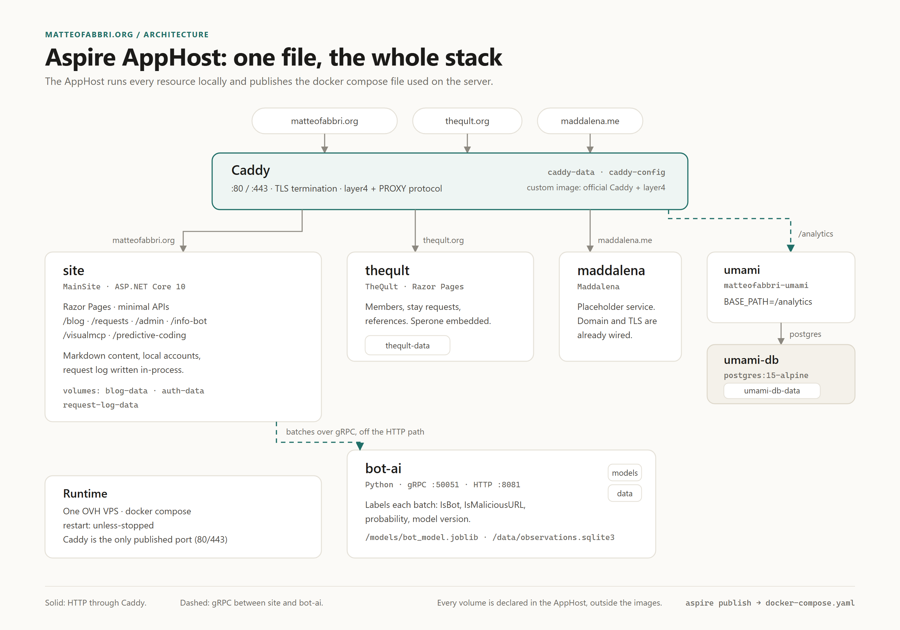
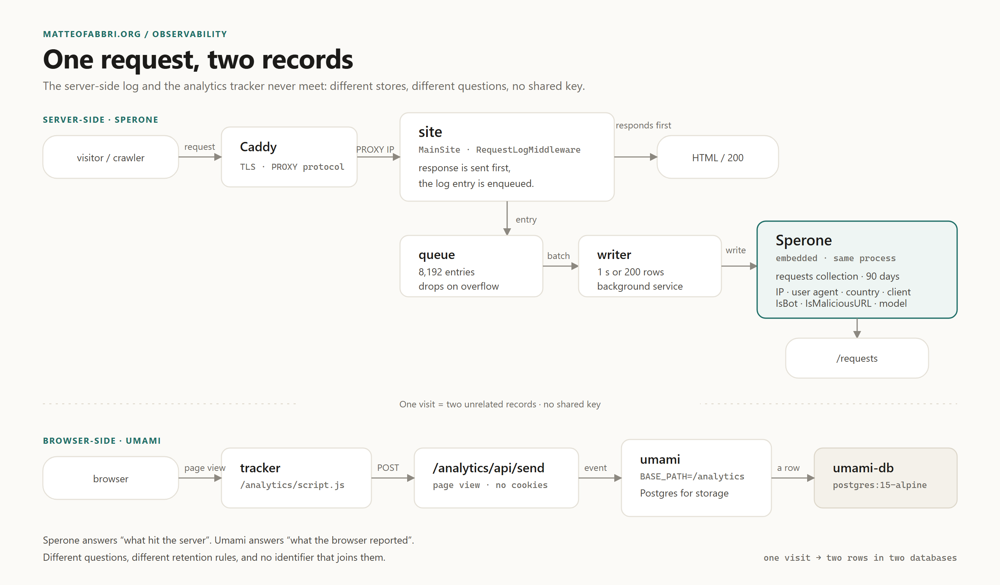

# matteofabbri.org

**Not a blog, not even a sandbox.**

From the outside this repository is a personal blog: posts, tags, an RSS feed, a home
page with the most recent articles. The format is correct; the description is not.

This is a production test bench that also publishes articles. The request log, the bot
classifier, the calendar integration, the analytics stack and a second community site all
run on the real domain, against real traffic, next to the writing. The long version of
the idea is the [About page](https://matteofabbri.org/about).



## The rules

1. **The experiment runs in production.** No demo branch, no staging copy with mock data.
   If a feature is not deployed, it is a draft.
2. **Every experiment has a delete path.** The request log turns off with one flag; the
   booking API answers 503 without a calendar and the site starts anyway; analytics is off
   when the website id is empty.
3. **The data has to be real.** `/requests` shows what the middleware wrote, and the same
   rows feed the map, the chart, the filters, the table and the CSV.
4. **Writing is the acceptance test.** A feature is finished when the post can explain the
   problem, the decision and the cost.
5. **No dependency I cannot keep.** Self-hosted beats SaaS; a file on a volume beats a
   managed database; one small server beats a cluster.

Removal is a valid outcome. When an experiment ends, the post stays.

## One AppHost, the whole stack

Everything is declared in one Aspire AppHost: projects, containers, endpoints and volumes.
`aspire run` starts the graph locally; `aspire publish` turns the same graph into the
docker compose file used on the server. There is no second description of the
architecture to keep in sync.

| Resource | What it is |
|---|---|
| `caddy` | The only published ports (80/443). TLS, layer4 and the PROXY protocol. |
| `site` | `MainSite`: blog, `/requests`, `/admin`, `/info-bot`, `/visualmcp`, `/predictive-coding`, booking API. |
| `theqult` | `TheQult`: a hospitality community, second Razor Pages app. |
| `maddalena` | A placeholder service; domain and TLS are already wired. |
| `umami`, `umami-db` | Cookieless analytics under `/analytics`, with PostgreSQL. |
| `bot-ai` | A Python service that labels request batches over gRPC. |

State lives outside the images, in named volumes: `blog-data`, `auth-data`,
`request-log-data`, `theqult-data`, `umami-db-data`, `botdetection-models`,
`botdetection-data`, plus `caddy-data` and `caddy-config` for the certificates. Rebuilding
a container does not take the posts, the accounts or the log with it.

## One request, two records



Caddy terminates TLS and forwards to the site with the PROXY protocol, so the application
sees the real client address instead of the proxy. The request-log middleware enqueues an
entry and returns; the response does not wait for a database. A background writer flushes
the queue every second or every 200 rows into Sperone, the embedded store that runs in the
same process. The queue holds 8,192 entries and drops new ones when full, because losing a
log line is better than slowing the site.

The bot classifier is off that path too: the writer sends batches to `bot-ai` over gRPC
and stores `IsBot`, `IsMaliciousURL`, the probability and the model name. If the model is
down, the flags stay null and the log is written anyway. Nothing is blocked.

A visitor also produces a second, unrelated record: the Umami tracker calls
`/analytics/api/send`, and Umami writes a page view to PostgreSQL. Sperone answers "what
hit the server"; Umami answers "what the browser reported". There is no shared key between
the two, and there will not be one.

## What runs here

- **The blog** — Markdown files on a volume, no database. The home page renders the first
  five posts in full; posts at `/blog/{slug}`, tags, RSS, two sitemaps (HTML and XML).
- **`/about`** — the manifesto, editable from `/admin/page/about`, with the Aspire AppHost
  and request-path diagrams.
- **`/requests`** — the request log made public: offline GeoIP map, visitors chart, country
  table, filters, CSV export, bot and malicious URL flags.
- **`/info-send` and `/info-bot`** — a public endpoint stores whatever raw body a bot posts;
  a public page shows it back.
- **`/admin`** — local accounts in SQLite (PBKDF2), no external identity provider.
- **`/visualmcp` and `/predictive-coding`** — two documentation areas rendered by the same
  app from two projects.
- **`theqult.org`** — members, stay requests and references on embedded Sperone.
- **`/booking`** — a week view over CalDAV. Parked: without a calendar backend the API
  answers 503 and the rest of the site does not care.

It is not a portfolio, not a product, not a news feed, not permanent. The archive is the
record; the code is allowed to move.

## Running it locally

Requirements: .NET 10 SDK, Docker, and the Aspire CLI.

```bash
aspire run
```

The AppHost starts Caddy, the site, TheQult, Maddalena, Umami and the Python service. The
site alone can also run on its own:

```bash
dotnet run --project MatteoFabbri.org/MainSite
# http://localhost:5180
```

Useful local switches:

- `Calendar__UseFake=true` gives the booking API an in-memory calendar with no credentials.
- `Auth__BootstrapUsername`, `Auth__BootstrapPassword` and `Auth__BootstrapDisplayName`
  create the first `/admin` account on a brand-new auth database; remove them afterwards.
- The Umami image must be built with `--build-arg BASE_PATH=/analytics` (the base path is a
  build-time setting); the deploy workflow builds it on the server when missing.

## Content is not code

Posts are Markdown files with YAML front matter. Locally they live in
`MainSite/App_Data/blog`; in production they live in the `blog-data` volume, never
in the image. Images go in the `media/` folder next to them and are served from
`/blog/media/{name}`. The editor at `/admin` writes the same files, so a post can be
created either way and the content survives a redesign of the site.

Long-form pages are stored the same way, under `pages/` in the same volume. `/about` is
the first: edit it at `/admin/page/about`, and the change is live immediately — no
deploy. On a fresh volume it is seeded from the built-in copy in
`MainSite/Blog/AboutPage.cs`.

The content folders are intentionally git-ignored: the repository contains the software,
the volumes contain the writing. Back up `blog-data` and `auth-data`.

## Tests

```bash
dotnet test MatteoFabbri.org.slnx
```

The two xUnit projects (`MainSite.Tests`, `TheQult.Tests`) run the full suite. The
Python service has its own suite; see [bot-detection/README.md](bot-detection/README.md).

## Deploy

A push to `main` runs `.github/workflows/deploy.yml`: it builds the three site images,
ships them to the server and restarts the changed containers. The workflow deliberately
does not touch `docker-compose.yaml` or `.env`, so changes to the AppHost or the compose
graph need a manual deploy (`publish.ps1` from this repository, then `docker compose up -d`
on the server). Volumes survive either path.

Mail is not part of this stack (the MX records are on OVH) and the booking backend is
currently unconfigured, by design.

## Repository layout

| Path | What |
|---|---|
| `MatteoFabbri.org.AppHost/` | Aspire AppHost: resources, `caddy/Caddyfile`, compose publishing. |
| `MainSite/` | Personal site: blog, `/requests`, `/admin`, `/info-bot`, docs areas, booking API. |
| `TheQult/` | Hospitality community, its own Razor Pages app. |
| `Maddalena/` | Placeholder service for `maddalena.me`. |
| `bot-detection/` | Python service: gRPC contract, model, training, HTTP health endpoint. |
| `MatteoFabbri.org.ServiceDefaults/` | Telemetry, health checks and service discovery shared by the apps. |
| `MainSite.Tests/`, `TheQult.Tests/` | xUnit test projects. |
| `deploy/` | Deployment runbook, ffmpeg image layer, server scripts. |
| `docs/` | Repository documentation and the sources of the diagrams above. |
| `external/` | Git submodules: SPERONE (embedded store) and PredictiveCoding. |

## Language

The public site and its content are English-only. The code is being migrated to the same
rule; the remaining Italian comments and identifiers are known debt, not a convention.
